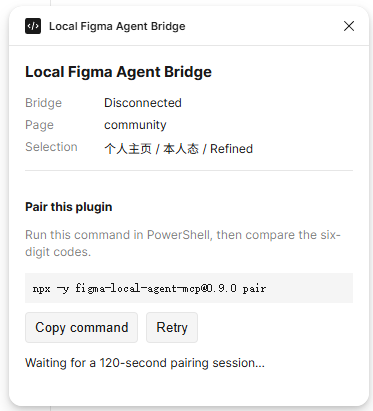
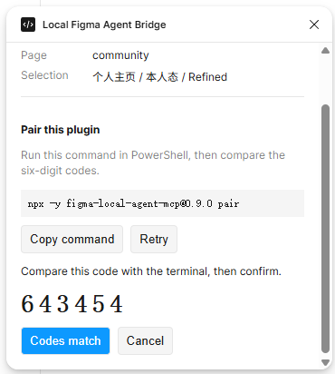
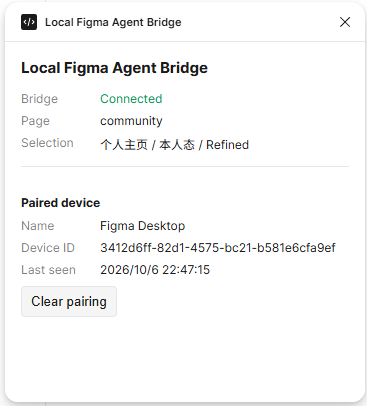

# Local Figma Agent MCP

Let local coding agents read Figma Design documents safely, carry design evidence and assets into front-end projects, and create reviewable design changes in isolated Proposal copies.

[中文](README.md) · [English documentation](docs/en-US/README.md) · [Latest release](https://github.com/Lancasteerr/figma_bridge_agent/releases/latest) · [Report an issue](https://github.com/Lancasteerr/figma_bridge_agent/issues)

> Local-first · No direct source edits · No cloud relay · No telemetry

This unofficial developer tool is distributed through GitHub. It is not affiliated with or endorsed by Figma and is not published to Figma Community. Figma data and bridge credentials stay on the local loopback interface.

## What it does

| Capability               | Description                                                                                         |
| ------------------------ | --------------------------------------------------------------------------------------------------- |
| Design-to-code           | Give the agent bounded design semantics, assets, and freshness evidence for repository-aware coding |
| Local reads              | Read the current file, selection, node tree, asset facts, styles, variables, fonts, and Inspect CSS |
| Implementation workunits | Keep facts in disk JSONL while tracking code mappings, state, and source freshness in a workunit    |
| Asset delivery           | Extract original images or render nodes into an explicitly bound Agent workspace                    |
| Safe edits               | Clone targets and required layout context, then edit only inside an isolated Proposal               |
| Declarative generation   | Validate a complete DesignPlan before atomically creating a new Proposal                            |
| Multi-client reuse       | Share one managed Bridge Daemon across multiple local MCP Adapters                                  |

The Bridge is not a framework-specific code generator. It gives the coding agent structured design evidence, safe asset delivery, and source-freshness checks; the agent writes code using the target repository's stack, component library, and conventions.

The MCP Server statically registers 25 bounded tools. Apart from `figma_status`, names use the `figma_inspect_`, `figma_frontend_`, and `figma_design_` domain prefixes; there is no activation step. See the [MCP tool reference](docs/en-US/tools.md) for the complete list and call sequences.

## Interface preview

### First-time pairing

Before pairing, the plugin shows the PowerShell command. Once pairing begins, the terminal and plugin display a six-digit code for manual comparison.

<p align="center">
  
  
</p>

### Connected state

After pairing, the plugin window shows the Bridge connection, current document, and most recent connection time.

<p align="center">
  
</p>

Agent changes appear as an isolated Proposal on the Figma canvas, ready to review beside the source design.

## Quick start

### Requirements

- Windows
- Node.js 20 or newer
- Figma Desktop
- A coding agent with local stdio MCP or Agent Plugins 1.0 support

Regular users do not need Git, pnpm, or a source checkout. Open the [latest GitHub Release](https://github.com/Lancasteerr/figma_bridge_agent/releases/latest), note the version without the `v` prefix, and replace `<VERSION>` below with it. The Figma plugin ZIP, MCP npm package, and Agent Plugin must come from the same version.

### 1. Choose one installation method

Both methods provide the same static tools and workflow guidance. Choose exactly one:

- **Install the Agent Plugin**: for Codex, Cursor, and GitHub Copilot, which currently have entry points maintained by this project. It automatically supplies the MCP configuration plus design-to-code and safe Proposal workflow guidance. Follow the [Agent Plugin installation guide](docs/en-US/install-plugin.md).
- **Configure the MCP Server directly**: for Claude Code, Claude Desktop, and other local stdio hosts. You add the MCP configuration manually, and the Skill is not installed automatically. Follow the [direct MCP installation guide](docs/en-US/install-mcp-server.md).

Do not install the Agent Plugin and manually register the same MCP Server at the same time, or the client may load duplicate tools. See [choose an installation method](docs/en-US/configuration.md) for the complete comparison.

### 2. Import the Figma plugin

Download `figma-agent-bridge-plugin-v<VERSION>.zip` from the [latest GitHub Release](https://github.com/Lancasteerr/figma_bridge_agent/releases/latest) and extract it to a stable directory.

In **Figma Desktop → Plugins → Development → Import plugin from manifest**, select:

```text
figma-agent-bridge-plugin/manifest.json
```

### 3. Complete first-time pairing

Start **Local Figma Agent Bridge** in Figma and keep its window open. Then run this command in PowerShell:

```powershell
npx -y figma-local-agent-mcp@<VERSION> pair
```

Click **Codes match** only when the six-digit codes in the terminal and plugin are identical. After a successful pairing, the plugin authenticates and reconnects automatically on later starts.

### 4. Verify the connection

Restart the MCP client or open a new agent session. Confirm that all 25 static tools are discoverable, then ask the agent to call `figma_status`. A healthy result contains the current Figma file, page, selection, and an `UNBOUND` or `BOUND` workspace. Protocol 11 compatibility is checked internally during the authenticated connection.

For Development builds, source builds, and direct MCP troubleshooting, see the [direct MCP installation guide](docs/en-US/install-mcp-server.md).

## Basic usage

### Implement code from a design

1. Open the target front-end project, then open the Design file and **Local Figma Agent Bridge** in Figma Desktop. Ask the agent to call `figma_status`, then bind the real workspace with `figma_frontend_bind_workspace`.
2. Choose **high-fidelity reproduction** or **engineering adaptation** that prioritizes the existing design system. When unspecified, the Agent Plugin workflow defaults to high fidelity.
3. For a large page, call `figma_frontend_index_scope` first and choose a bounded root. Every implementation scope starts with `figma_frontend_prepare_workunit`, with only one active workunit at a time.
4. Before visual code, the agent updates node-to-code mappings in `implementation.json`, reads JSONL facts only by node ID or name, and exports images or SVGs through the corresponding `workUnitId`.
5. Before completion, call `figma_frontend_check_workunit_source` and require `FRESH`. Screenshots are a final appearance check, not a pixel-diff infrastructure.

Example requests:

- “Implement the selected card as a high-fidelity React component in this project. Prefer existing tokens, then compare the result with a fresh Figma render.”
- “Index the current page first, choose bounded workunits that fit this repository, then generate code one scope at a time without loading the entire page's facts.”
- “Implement the current page using the existing design system and list every visible adaptation from Figma.”

See the [front-end implementation workflow](plugins/figma-local-agent/skills/figma-local-agent/references/frontend-implementation.md) and [workunit workflow](plugins/figma-local-agent/skills/figma-local-agent/references/workunits.md) for scope selection, asset decisions, and visual acceptance rules.

### Create or edit a Proposal in Figma

1. Open the target Design file and **Local Figma Agent Bridge** in Figma Desktop.
2. Check `figma_status`, use the `figma_inspect_` and `figma_design_` tools directly, select the relevant nodes, and describe the read, edit, or generation task.
3. For an existing design, the agent first creates an isolated Proposal. For complex generation from scratch, it validates a complete DesignPlan first.
4. Review the resulting Proposal on the canvas. Public write tools never overwrite the source artwork.

Example requests:

- “Read the current selection and explain its hierarchy, Auto Layout, fonts, and visual styles without changing Figma.”
- “Duplicate the selected card as a Proposal, adjust its spacing and title, then render the result for review.”
- “Use DesignPlan to create a new login-card Proposal. Validate the complete plan first, then apply it and render a preview.”

## How it works

```text
Current page of the current Design file
  ↕ Figma Plugin API
Figma plugin UI and main process
  ↕ per-device authenticated ws://127.0.0.1:3900/
Local Bridge Daemon
  ↕ authenticated ws://127.0.0.1:3900/mcp
MCP Adapter
  ↕ independent stdio session
Coding Agent
  ├─ reads design facts, workunits, and assets → generates code in a local front-end project
  └─ sends bounded design writes → creates or edits an isolated Proposal in Figma
```

During first-time pairing, the user compares a six-digit code. Later connections authenticate each plugin device with an independent credential and fresh proofs. The Bridge listens only on `127.0.0.1`; it has no remote or cloud transport.

When implementing code from a design, every bounded scope starts with a stable workunit. A large region or page can be structurally indexed before scopes are selected. Complete facts remain in immutable disk JSONL while public MCP results contain only purpose-bound paths, completeness state, and required control tokens; per-file digests, byte counts, and bodies do not cross that boundary. `implementation.json` tracks source, state, code mappings, assumptions, and unresolved differences and is never overwritten after creation.

When editing an existing design, the Bridge clones the targets and required layout context into a Page-level Proposal. Consecutive writes use complete-tree fingerprints to protect concurrent edits. To generate a complex design from scratch, an agent can validate a DesignPlan and then use the single-use, five-minute validation ID to create the Proposal atomically.

See the [architecture and safety model](docs/en-US/architecture.md) for implementation details.

## Security boundaries

- Public write tools can only create a Proposal or edit nodes inside a Bridge-marked Proposal root.
- Input assets accept Base64 only. The Server does not fetch URLs or read caller-provided local files.
- Team Library is never queried. Place an external Instance on the current page before reusing it.
- Workunit source bodies are written only to the session directory. Public results retain relative paths, completeness information, and the source fingerprint required for workunit freshness, without injecting complete design facts or internal digests into conversation.
- Structural indexes, workunits, and asset exports share one immutable workspace binding. Every MCP Adapter starts `UNBOUND`; during implementation, the agent submits the exact cwd from its own task execution environment with the latest session ID before persistent writes begin. Temporary tree and render artifacts remain available while unbound.
- The Bridge does not decide component responsibilities, code mappings, or framework patterns. The agent makes those implementation decisions from the user's request and target repository.
- Only one Figma plugin window can be active at a time. Remote-only agents cannot reach the local Bridge.

See [security notes](docs/en-US/security.md) for complete boundaries and operational guidance.

## Documentation

| Document                                                     | Audience                   | Contents                                                 |
| ------------------------------------------------------------ | -------------------------- | -------------------------------------------------------- |
| [Documentation home](docs/en-US/README.md)                   | Everyone                   | Choose documentation by task                             |
| [Choose an installation method](docs/en-US/configuration.md) | Users                      | Compare the Agent Plugin and direct MCP routes           |
| [Install the Agent Plugin](docs/en-US/install-plugin.md)     | Plugin client users        | Stable Codex, Cursor, and Copilot installation           |
| [Configure MCP directly](docs/en-US/install-mcp-server.md)   | stdio host users           | Claude, generic hosts, Development, and source builds    |
| [MCP tool reference](docs/en-US/tools.md)                    | Users and agent developers | Workflow tool sets, write boundaries, and call sequences |
| [Architecture and safety model](docs/en-US/architecture.md)  | Developers                 | Processes, protocol, Proposal, and DesignPlan lifecycles |
| [Development guide](docs/en-US/development.md)               | Contributors               | Monorepo, commands, tests, and builds                    |
| [End-to-end acceptance](docs/en-US/acceptance.md)            | Contributors               | Distribution and Figma scenario validation               |

## Local development

Contributors need Node.js 20+ and pnpm 11.19.0:

```powershell
pnpm install --frozen-lockfile
pnpm check
pnpm build:release
```

`pnpm check` validates the Agent Plugin, type-checks, lints, checks formatting, runs tests, and builds. `pnpm build:release` creates the Figma plugin ZIP, npm tarball, portable Agent Plugin ZIP, and `SHA256SUMS` under `artifacts/`.

See the [development guide](docs/en-US/development.md) for the environment and repository structure.

## Current scope

The current stable release supports Windows, local stdio, multiple MCP Adapters, one active Figma plugin, and the current page of the current Design file. It supports reads, renders, workunits, asset exports, controlled Proposal edits, and validated DesignPlans. A connected coding agent can use these capabilities to generate code in a local front-end project.

The current release does not provide a Windows installer, automatic updates, remote transport, cloud sync, arbitrary JavaScript, direct source-artwork writes, general deletion, Instance detaching, or Team Library queries. The Bridge also has no built-in one-click generator for a particular framework; the connected coding agent performs code generation.

## License

This project is available under the [MIT License](LICENSE). Review generated Proposals and exported content in your own environment before use.
